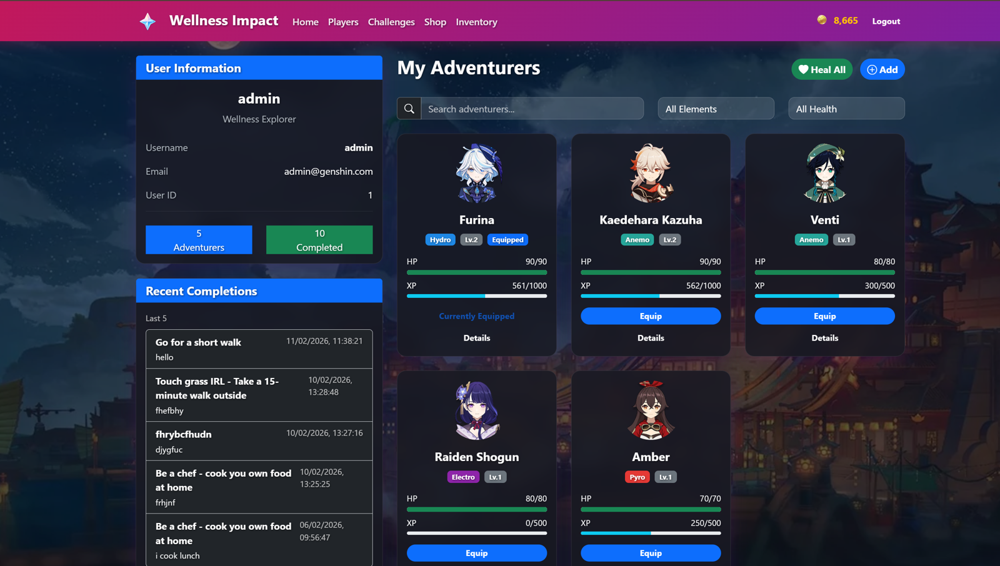

# Wellness Impact

A full-stack web app that turns wellness challenges into an RPG. Built with **Express.js and MySQL** for Backend Development (CA2) at Singapore Polytechnic.



## What it does
- Register and log in securely with JWT authentication
- Equip characters that each have an element (Pyro, Hydro, Anemo, Electro, Dendro, Cryo, Geo)
- Play an element-based minigame before completing a wellness challenge
- Earn Mora (points) and XP, and level up your characters
- Buy weapons, artifacts, characters and food in the shop, and manage them in your inventory
- Cooldowns and HP limits are enforced by the backend, so they can't be bypassed from the browser

## Tech stack
Node.js · Express.js · MySQL (`mysql2`) · JWT · bcrypt · HTML / CSS / JavaScript

## How it works
1. A user registers or logs in. The backend issues a **JWT**, which the frontend stores in `localStorage`.
2. The user equips a character in the inventory. Its element decides which minigame is played.
3. The user picks a wellness challenge and plays the minigame. The backend first checks HP and cooldown.
4. If the user wins, the completion form unlocks. After submitting it, the user gets Mora, the equipped character gets XP, and the character levels up if it reaches the XP threshold.
5. The challenge then goes on a **30-minute cooldown** before it can be attempted again.
6. Mora can be spent in the shop, and purchased items go straight to the inventory.

## Minigames
| Element | Minigame |
|---|---|
| Pyro | Memory and reaction challenge |
| Hydro | Click speed and accuracy |
| Anemo | Directional input and reflexes |
| Electro | Reaction timing |
| Dendro | Growth balance and decision making |
| Cryo | Timed breaking challenge |
| Geo | Logic and sequence puzzle |

HP is reduced after every attempt, with a bigger loss for a failed attempt. A character with 0 HP can't start new challenges. Food items restore HP.

## Shop
Weapons and artifacts give stat boosts or passive bonuses, and each character can equip one of each. Characters can be bought directly, and only one can be equipped at a time. Food is consumed on use. The backend checks that the item exists, the user is logged in, and the Mora balance is enough.

## Security
- Passwords are hashed with **bcrypt** before they are stored
- JWT is checked on every protected route
- Role-based access separates admin and regular users
- Ownership, cooldowns and minigame completion are all validated on the server

## API overview
All routes start with `/api`, and protected routes need a valid JWT.

| Area | Endpoints |
|---|---|
| Users | `POST /users/register`, `POST /users/login`, `GET /users/me`, `GET /users` (admin), `GET /users/:user_id` (admin) |
| Characters | `POST /characters`, `GET /characters`, `GET /characters/equipped`, `PUT /characters/:user_character_id/equip` |
| Inventory | `GET /inventory`, `PUT /inventory/weapon/:id/equip`, `PUT /inventory/artifact/:id/equip`, `POST /inventory/food/:id/use` |
| Shop | `GET /shop/items/all`, `POST /shop/{weapons,artifacts,characters,food}/:item_id/purchase` |
| Challenges | `GET /challenges`, `POST /challenges`, `DELETE /challenges/:challenge_id` |
| Minigame | `GET /minigame/challenge/:id/can-attempt`, `POST /minigame/challenge/:id/attempt` |
| Completions | `POST /completions/challenge/:challenge_id` |

Typical status codes: `201` created, `400` invalid input or not enough Mora, `401` not logged in, `403` not allowed, `404` not found, `409` duplicate user, `429` challenge on cooldown.

## Getting started

### Prerequisites
Node.js v14 or higher, npm, and a MySQL server.

### 1. Clone and install
```bash
git clone https://github.com/Chloelzx25/wellness-impact.git
cd wellness-impact
npm install
```

### 2. Create a `.env` file
Create a file named `.env` in the root folder. It is not included in this repo.
```
DB_HOST=localhost
DB_USER=root
DB_PASSWORD=your-password
DB_DATABASE=wellness
JWT_SECRET_KEY=your-secret-key
JWT_EXPIRES_IN=15m
JWT_ALGORITHM=HS256
```
There must be no spaces around `=`.

### 3. Set up the database
Create an empty database with the name you used in `DB_DATABASE`, then run:
```bash
npm run init_tables
```
This creates the tables and adds sample data.

### 4. Start the server
```bash
npm run dev
```
The app runs at `http://localhost:3000`.

## What I learned
- Designing REST APIs and structuring an Express project
- Enforcing business rules on the server instead of trusting the client
- Protecting routes with JWT and hashing passwords with bcrypt

## Notes
- Never commit your `.env` file. Make sure it is listed in `.gitignore`.
- This is a student project. Character art belongs to its original owners and the project is not affiliated with them.
